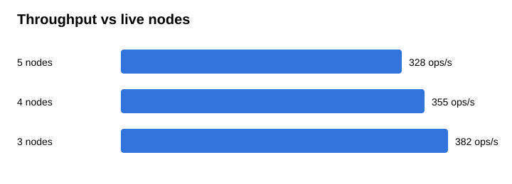
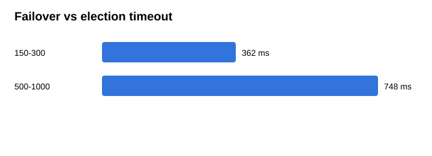
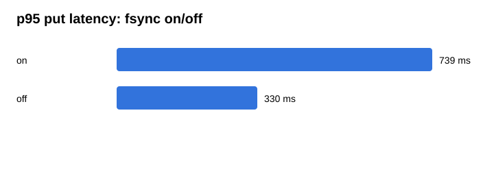

# Raft Benchmark Report

Workload for parts A/C: 100% `put`, `threads=100`, `totalOps=10000`.

## Результаты

| part  | scenario      | liveNodes | electionTimeoutMs | fsync | threads | totalOps | throughputOpsSec |  avgMs |  p50Ms |  p95Ms |   p99Ms | failoverMs |
|-------|---------------|----------:|-------------------|-------|--------:|---------:|-----------------:|-------:|-------:|-------:|--------:|-----------:|
| A     | all-alive     |         5 | 150-300           | on    |     100 |    10000 |              328 | 303.38 | 307.10 | 691.51 |  992.62 |            |
| A     | one-dead      |         4 | 150-300           | on    |     100 |    10000 |              355 | 280.61 | 281.13 | 619.15 |  969.93 |            |
| A     | two-dead      |         3 | 150-300           | on    |     100 |    10000 |              382 | 260.96 | 283.10 | 508.46 |  825.05 |            |
| B     | failover-fast |         4 | 150-300           | on    |     1   |      1   |                  |        |        |        |         |        362 |
| B     | failover-slow |         4 | 500-1000          | on    |       1 |        1 |                  |        |        |        |         |        748 |
| C     | fsync-on      |         5 | 150-300           | on    |     100 |    10000 |              331 | 301.15 | 277.27 | 738.60 | 1087.38 |            |
| C     | fsync-off     |         5 | 150-300           | off   |     100 |    10000 |             1107 |  89.75 |  19.31 | 329.61 |  558.27 |            |

## Графики

## Итог

### A. Throughput vs live nodes

Пропускная способность изменилась с `328 ops/s` при 5 живых узлах до `355 ops/s` при 4 и `382 ops/s` при 3.
Кластер продолжает коммитить записи, пока доступно большинство: для 5 узлов кворум равен 3. 
При двух упавших узлах остаются ровно 3 живые реплики, то есть это последняя безопасная рабочая конфигурация; 
потеря еще одного узла сделает majority commit невозможным.

### B. Election timeout vs failover

Failover при election timeout `150-300 ms` занял `362 ms`, а при `500-1000 ms` — `748 ms`. Более короткий timeout быстрее обнаруживает потерю лидера, но в шумной сети он также повышает вероятность лишних выборов и может мешать здоровому лидеру.

### C. fsync cost

При `fsync on` p95 latency составила `738.60 ms`; при `fsync off` p95 latency составила `329.61 ms`, то есть разница в этом прогоне примерно `2.24x`. Durable-режим медленнее, потому что каждый append в журнал и каждое обновление term/vote ждут сброса данных на диск. Без `force()` система работает быстрее, но при потере питания запись может пропасть после того, как узел уже подтвердил ее, что нарушает предположение Raft о durability majority.
